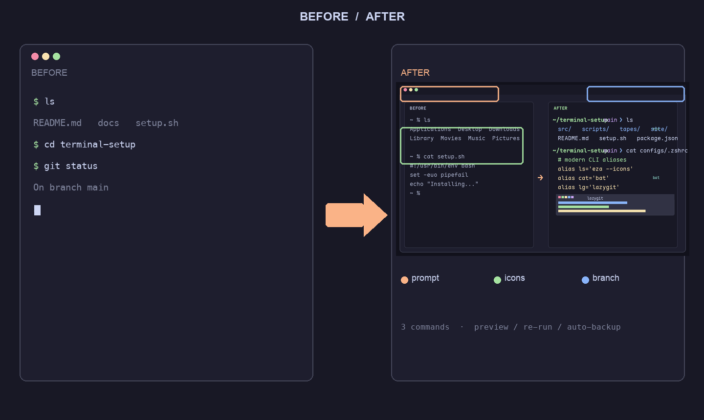

# 🐻‍❄️ Polar Bear

<!-- BEGIN shared:hero -->
**After installing, type just 3 commands — and your terminal looks like this.**

Old configs auto-backed up · Preview with --dry-run · Safe to re-run

Not another dotfiles repo — a previewable, repeatable installer that won't break your setup.

[🇨🇳 中文](README_CN.md) · [Website](https://webxiongda.github.io/terminal-setup/) · [★ Star](https://github.com/webxiongda/terminal-setup/stargazers) · [MIT](LICENSE)
<!-- END shared:hero -->

<!-- BEGIN shared:preview -->
<p align="center">
  
</p>
<p align="center"><sub>BEFORE → AFTER, just 3 commands away. [Watch the video guide →](https://webxiongda.github.io/terminal-setup/#videos)</sub></p>
<!-- END shared:preview -->

<!-- BEGIN shared:get3 -->
**What you get in 3 things**

1. 🎨 Colorful prompt: Catppuccin theme + git branch
2. 🚀 Modern ls · cat: eza / bat with icons & highlights
3. 🧭 Smart jumps + fuzzy search: zoxide / fzf
<!-- END shared:get3 -->

<!-- BEGIN shared:install -->
## Quick Start

> **Read the script first.** Both lines below install tools and write dotfiles; open [setup.sh](setup.sh) and review it before you pick one.

```bash
# One line — auto-clones and sets everything up
bash <(curl -fsSL https://raw.githubusercontent.com/webxiongda/terminal-setup/main/setup.sh)

# Or clone, review setup.sh, then run
git clone https://github.com/webxiongda/terminal-setup.git && cd terminal-setup && ./setup.sh
```
<!-- END shared:install -->

<!-- BEGIN shared:platforms -->
## Supported Platforms

| Platform | Status | Package manager |
|---|---|---|
| 🍎 **macOS** | ✅ Primary — battle-tested | Homebrew |
| 🐧 **Debian / Ubuntu** | 🧪 Experimental — works but not extensively tested | apt + bundled binaries |
| 🪟 **Windows (WSL)** | 🧪 Experimental — works but not extensively tested | apt (inside WSL) |
| 🪟 **Windows (native)** | ⛔ Not supported | Use WSL instead |
<!-- END shared:platforms -->

## Core Features

<!-- BEGIN shared:features -->
- 🎨 **Unified theme** — Starship follows your system's light/dark mode (Latte / Mocha); colors and font are set in one go.
- 🚀 **Modern CLI** — eza / bat / fd / rg / fzf / zoxide / lazygit / delta, all covered and ready; fd = faster find, rg = faster grep — system find/grep are left untouched to avoid flag conflicts.
- 📦 **One-command install** — Zero config, ready in minutes. Local tweaks live in ~/.zshrc.local and survive re-runs.
- 🖥 **Terminal agnostic** — Use your existing terminal; Warp recommended (optional, not installed).
- 🔤 **Chinese friendly** — Maple Mono NF CN font: crisp glyphs, icons and Chinese text.
- 🧪 **Previewable** — --dry-run prints every step first; non-interactive runs never block on prompts.
<!-- END shared:features -->

## What It Does

<!-- BEGIN shared:what -->
Touches only what it should — existing configs are backed up first.

1. Installs a package manager (Homebrew on macOS, apt on Linux).
2. Installs Zsh plus autosuggestions, syntax highlighting and completions.
3. Installs modern CLI tools and deploys the Catppuccin Mocha Starship prompt.
4. Deploys configs; existing files are timestamped and backed up first, local overrides go to ~/.zshrc.local.
<!-- END shared:what -->

<details>
<summary>25+ tools — the full stack</summary>

<!-- BEGIN shared:tools -->
| Component | What it does |
|---|---|
| [Starship](https://starship.rs) | Cross-shell prompt (Catppuccin Mocha) |
| [Zsh](https://www.zsh.org) | Shell with autosuggestions, highlighting and completion |
| [zsh plugins](https://github.com/zsh-users) | autosuggestions / syntax-highlighting / completions |
| [Maple Mono NF CN](https://github.com/subframe7536/maple-font) | CJK-capable Nerd Font with icons and powerline glyphs |
| [eza](https://github.com/eza-community/eza) | ls with icons, git status and tree view |
| [bat](https://github.com/sharkdp/bat) | cat with syntax highlighting and line numbers |
| [fd](https://github.com/sharkdp/fd) | find, but fast and intuitive |
| [ripgrep](https://github.com/BurntSushi/ripgrep) | grep, orders of magnitude faster |
| [fzf](https://github.com/junegunn/fzf) | Fuzzy finder (Ctrl+R / Ctrl+T / Alt+C) |
| [btop](https://github.com/aristocratos/btop) | Beautiful system monitor TUI |
| [zoxide](https://github.com/ajeetdsouza/zoxide) | A smarter cd that learns your habits |
| [jq](https://github.com/jqlang/jq) | JSON processor |
| [tldr](https://github.com/tldr-pages/tldr) | Simplified man pages with examples |
| [delta](https://github.com/dandavison/delta) | git diffs with syntax highlighting |
| [lazygit](https://github.com/jesseduffield/lazygit) | Terminal UI for git |
| [fnm](https://github.com/Schniz/fnm) | Fast Node version manager (Rust) |
| [Zellij](https://zellij.dev) | Modern terminal multiplexer (optional) |
| [fastfetch](https://github.com/fastfetch-cli/fastfetch) | Fast system information, modern neofetch |
| [procs](https://github.com/dalance/procs) | Colorful ps replacement |
| [sd](https://github.com/chmln/sd) | Intuitive sed replacement |
| [hyperfine](https://github.com/sharkdp/hyperfine) | Command-line benchmarking tool |
| [uv](https://github.com/astral-sh/uv) | Blazing-fast Python package manager |
| [git + delta](https://git-scm.com) | git diff is paged through delta by default |
| [Meslo 字体](https://github.com/meslo-fonts/MesloLGS-NF) | Bundled Nerd Font fallback on Linux |
| [Your terminal](https://www.warp.dev) | No emulator installed; Warp recommended (optional) |
<!-- END shared:tools -->

</details>

## Docs & Links

- [Website](https://webxiongda.github.io/terminal-setup/) — highlights and video guides
- [中文文档](README_CN.md) · [简体中文说明、平台细节与排障都在这里](README_CN.md)
- [快捷键速查手册](docs/快捷键速查手册.md) · [开发大纲](docs/开发大纲.md)
- [视频讲解（官网）](https://webxiongda.github.io/terminal-setup/#videos)
- [设计规格](docs/superpowers/specs/2026-11-22-README与官网门面优化设计.md)

<details>
<summary>Safety, uninstall, troubleshooting, license</summary>

### Safety & backups

The script backs up existing dotfiles with timestamps before overwriting them:
`~/.zshrc.bak.<timestamp>`, `~/.config/starship.toml.bak.<timestamp>`.
Machine-specific overrides belong in `~/.zshrc.local`, which is sourced last and never overwritten.
Always review [setup.sh](setup.sh) before running it; use `--dry-run` to preview actions without changing anything.

### Re-run & update

```bash
./setup.sh --reinstall   # re-apply everything, ignoring "already installed" checks
./setup.sh --dry-run     # preview actions without changing anything
./setup.sh --skip-node   # skip fnm + Node.js if you manage Node yourself
```

### Uninstall

There is no built-in uninstall command. The script only installs tools and deploys configs:

- Restore configs from their timestamped backups.
- Remove CLI tools with your package manager (`brew uninstall <tool>` on macOS, `sudo apt remove <tool>` on Debian/Ubuntu).
- Delete `~/.zshrc.local` only if you no longer want local overrides.

### Troubleshooting

| Symptom | Fix |
|---------|-----|
| Icons render as boxes / missing glyphs | Install a Nerd Font in your terminal app and set it as the font (Maple Mono NF CN on macOS, bundled MesloLGS NF on Linux). |
| `bat: command not found` on Linux | The script symlinks `batcat` → `bat`; run `hash -r` or open a new shell. |
| `fd: command not found` on Linux | The script symlinks `fdfind` → `fd`; open a new shell. |
| Prompt looks wrong / no colors | Make sure your terminal supports 24-bit color, then `exec zsh` to reload config. |
| `command not found: eza` after setup | Open a new terminal, or re-run with `--reinstall`. |
| Chinese characters show as tofu | Use Maple Mono NF CN / MesloLGS NF and ensure locale is UTF-8 (`locale`). |
| Running inside native Windows (not WSL) | Native Windows is unsupported; install WSL (`wsl --install`) and run there. |

### License

MIT

</details>
