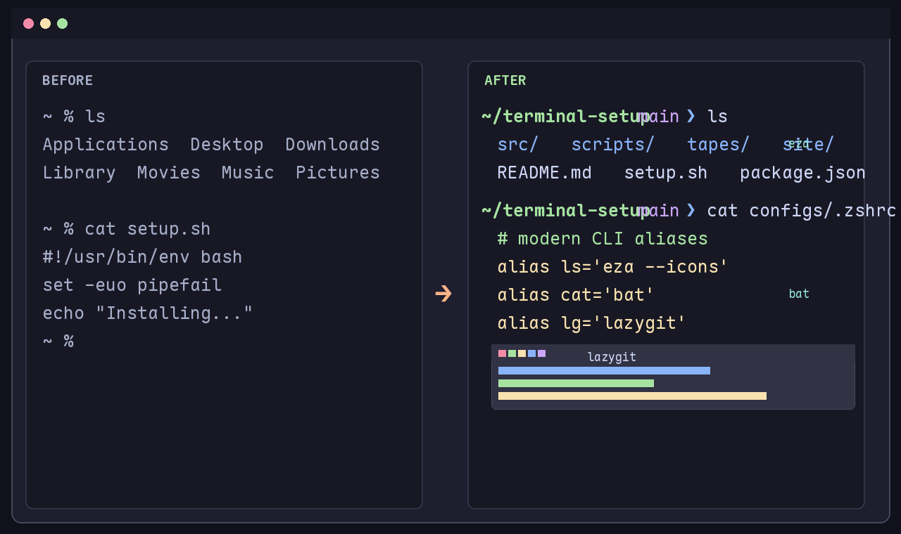

# 🐻‍❄️ Polar Bear

<!-- BEGIN shared:hero -->
**一条命令，把全新终端变成好看、开箱即用的样子。**

[🇬🇧 English](README.md) · [官网](https://webxiongda.github.io/terminal-setup/) · [⭐ Star](https://github.com/webxiongda/terminal-setup/stargazers) · [MIT](LICENSE)
<!-- END shared:hero -->

<!-- BEGIN shared:preview -->
<p align="center">
  
</p>
<p align="center"><sub>装好前 → 装好后，中间只隔一条命令。 [看视频讲解 →](https://webxiongda.github.io/terminal-setup/#videos)</sub></p>
<!-- END shared:preview -->

<!-- BEGIN shared:install -->
## 快速开始

> **先看脚本再运行。** 下面两条命令都会安装工具并写入 dotfiles；建议先打开 [setup.sh](setup.sh) 审查一遍，再选一条执行。

```bash
# 一行命令 — 自动 clone 并配置
bash <(curl -fsSL https://raw.githubusercontent.com/webxiongda/terminal-setup/main/setup.sh)

# 或者克隆、审查 setup.sh 后再运行
git clone https://github.com/webxiongda/terminal-setup.git && cd terminal-setup && ./setup.sh
```
<!-- END shared:install -->

<!-- BEGIN shared:platforms -->
## 支持平台

| 平台 | 状态 | 包管理器 |
|---|---|---|
| 🍎 **macOS** | ✅ 主力平台 — 长期使用验证 | Homebrew |
| 🐧 **Debian / Ubuntu** | 🧪 实验性 — 可用但未经长期测试 | apt + 内置二进制 |
| 🪟 **Windows (WSL)** | 🧪 实验性 — 可用但未经长期测试 | apt（WSL 内部） |
| 🪟 **Windows (原生)** | ⛔ 不支持 | 请先安装 WSL |
<!-- END shared:platforms -->

## 核心特性

<!-- BEGIN shared:features -->
- 🎨 **主题统一** — Starship 提示符自动跟随系统明暗模式（Latte / Mocha），配色与字体一次到位。
- 🚀 **现代 CLI** — eza / bat / fd / rg / fzf / zoxide / lazygit / delta 全覆盖，装好即用；fd = 更快的 find、rg = 更快的 grep，不覆盖系统 find/grep（避免 flag 冲突）。
- 📦 **一键安装** — 零配置，几分钟搞定；本机自定义放 ~/.zshrc.local，重跑不丢。
- 🖥 **不绑终端** — 用你现有的终端就行，推荐 Warp（可选，脚本不安装）。
- 🔤 **中文友好** — Maple Mono NF CN 字体，图标不乱码、中文清晰。
- 🧪 **可预览** — --dry-run 先打印每一步，非交互环境自动跳过问询不卡死。
<!-- END shared:features -->

## 它做了什么

<!-- BEGIN shared:what -->
只碰该碰的地方，已有配置先备份。

1. 安装包管理器（macOS 用 Homebrew，Linux 用 apt）。
2. 安装 Zsh 与插件：自动建议、语法高亮、补全。
3. 安装现代 CLI 工具，并部署 Catppuccin Mocha 主题的 Starship 提示符。
4. 部署配置文件；已有配置先按时间戳备份，本机自定义写入 ~/.zshrc.local。
<!-- END shared:what -->

<details>
<summary>完整工具清单（25+）</summary>

<!-- BEGIN shared:tools -->
| 组件 | 说明 |
|---|---|
| [Starship](https://starship.rs) | 跨 Shell 提示符（Catppuccin Mocha） |
| [Zsh](https://www.zsh.org) | 带自动建议、语法高亮与补全的 Shell |
| [zsh plugins](https://github.com/zsh-users) | autosuggestions / syntax-highlighting / completions |
| [Maple Mono NF CN](https://github.com/subframe7536/maple-font) | 支持中文的 Nerd Font，图标与 Powerline 字形齐全 |
| [eza](https://github.com/eza-community/eza) | 带图标、git 状态、树形视图的 ls |
| [bat](https://github.com/sharkdp/bat) | 带语法高亮和行号的 cat |
| [fd](https://github.com/sharkdp/fd) | 更快更直观的 find |
| [ripgrep](https://github.com/BurntSushi/ripgrep) | 比 grep 快几个数量级 |
| [fzf](https://github.com/junegunn/fzf) | 模糊查找器（Ctrl+R / Ctrl+T / Alt+C） |
| [btop](https://github.com/aristocratos/btop) | 漂亮的系统监控 TUI |
| [zoxide](https://github.com/ajeetdsouza/zoxide) | 更聪明的 cd，学习你的习惯 |
| [jq](https://github.com/jqlang/jq) | JSON 处理器 |
| [tldr](https://github.com/tldr-pages/tldr) | 带示例的简化版 man 手册 |
| [delta](https://github.com/dandavison/delta) | 带语法高亮的 git diff |
| [lazygit](https://github.com/jesseduffield/lazygit) | Git 终端 UI |
| [fnm](https://github.com/Schniz/fnm) | 快速 Node 版本管理器（Rust） |
| [Zellij](https://zellij.dev) | 现代终端复用器（可选） |
| [fastfetch](https://github.com/fastfetch-cli/fastfetch) | 极快的系统信息展示 |
| [procs](https://github.com/dalance/procs) | 彩色 ps 替代 |
| [sd](https://github.com/chmln/sd) | 直观的 sed 替代 |
| [hyperfine](https://github.com/sharkdp/hyperfine) | 命令行基准测试 |
| [uv](https://github.com/astral-sh/uv) | 极快的 Python 包管理器 |
| [git + delta](https://git-scm.com) | git diff 默认走 delta 高亮 |
| [Mesh / Meslo 字体](https://github.com/meslo-fonts/MesloLGS-NF) | Linux 上内置的 Nerd Font 回退 |
| [你的终端](https://www.warp.dev) | 脚本不安装终端模拟器，推荐 Warp（可选） |
<!-- END shared:tools -->

</details>

## 文档与链接

- [官网](https://webxiongda.github.io/terminal-setup/) — 特性展示与视频讲解
- [English](README.md) · [英文说明、平台细节与排障都在这里](README.md)
- [快捷键速查手册](docs/快捷键速查手册.md) · [开发大纲](docs/开发大纲.md)
- [视频讲解（官网）](https://webxiongda.github.io/terminal-setup/#videos)
- [设计规格](docs/superpowers/specs/2026-11-22-README与官网门面优化设计.md)

<details>
<summary>安全 / 卸载 / 排障 / 许可</summary>

### 安全与备份

脚本覆盖配置前会按时间戳备份：
`~/.zshrc.bak.<时间戳>`、`~/.config/starship.toml.bak.<时间戳>`。
本机自定义设置放在 `~/.zshrc.local`，总是最后加载且不会被覆盖。
运行前请先读 [setup.sh](setup.sh)，用 `--dry-run` 可以只预览、不改任何东西。

### 重跑与更新

```bash
./setup.sh --reinstall   # 重新应用全部配置，忽略「已安装」检查
./setup.sh --dry-run     # 只预览会做什么（不做任何改动）
./setup.sh --skip-node   # 跳过 fnm + Node.js（如果你想自己管理 Node）
```

### 卸载

脚本没有内置卸载命令，它只负责安装工具和部署配置：

- 从带时间戳的备份恢复配置。
- 用包管理器卸载工具（macOS 用 `brew uninstall <工具名>`，Debian/Ubuntu 用 `sudo apt remove <工具名>`）。
- 如果不再需要本机自定义配置，删除 `~/.zshrc.local`。

### 常见问题排查

| 现象 | 解决办法 |
|------|----------|
| 图标显示成方框 / 缺字形 | 在终端 App 里安装并启用 Nerd Font（macOS 用 Maple Mono NF CN，Linux 用内置的 MesloLGS NF）。 |
| Linux 上 `bat: command not found` | 脚本已建立 `batcat` → `bat` 软链；执行 `hash -r` 或重开 shell。 |
| Linux 上 `fd: command not found` | 脚本已建立 `fdfind` → `fd` 软链；重开 shell 即可。 |
| 提示符颜色不对 / 显示异常 | 确认终端支持 24 位色，然后 `exec zsh` 重新加载配置。 |
| 装完后 `eza` 找不到 | 重开终端，或用 `--reinstall` 重跑。 |
| 中文显示成豆腐块 | 使用 Maple Mono NF CN / MesloLGS NF，并确认 locale 为 UTF-8（`locale` 命令查看）。 |
| 在原生 Windows（非 WSL）下运行 | 原生 Windows 不支持；先 `wsl --install` 安装 WSL，再在 WSL 里运行脚本。 |

### 许可

MIT

</details>
