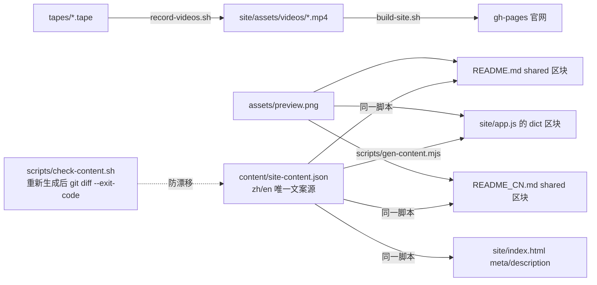

# README 与官网门面优化 — 产品需求文档（PRD）

日期：2026-11-22
状态：方案定义完成，待 owner 拍板 4 个决策点（见第 6 节）后流转前端
上游依据：`docs/superpowers/specs/2026-11-22-官网与视频讲解设计.md`、`docs/superpowers/plans/2026-11-22-官网与视频讲解实现计划.md`

## 0. 背景与本次目标

owner 诉求（原话要点）：
1. 已做网页端，但「不能直接映射到我的 GitHub README.md 文件」——README 本身也要构建得非常好。
2. 「还是不满意上面那个 MP4 图片」——展示方案需重做。
3. 介绍页简单明了，让用户通过 GitHub 就能快速了解项目并快速下载/安装。
4. 由管理员协调分派 strongest team（产品/前端/测试/运维）。

本 PRD 只定义方案与验收，不改 CLI 功能。证据基线（本次实读/实测）：

| 证据 | 结论 |
|---|---|
| `README.md` / `README_CN.md` 现状 | 首屏是「项目名 + 两张 80px 小图 + 一大段说明动图的文字 + 720px 宽的 `demo.gif`」，安装命令在第 60 行以后；工具清单 25 行表格全量展开 |
| `assets/demo.gif` | `file` = 1160×800；`ffprobe` = **仅 55 帧**；README 以 `width=720` 展示，文字再缩约 0.62 倍 |
| gh-pages 三个 mp4 | `ffprobe`：install 24.44s / 663,640B；daily 25.84s / 389,021B；git 21.40s / 326,817B；均 1200×640 / 25fps / h264。**总计约 1.38 MB** |
| `tapes/*.tape` | `Set FontSize 18`、`Set TypingSpeed 35ms`；三个 tape 都硬编码 `cd ~/Desktop/GitHub项目/06-开发工具/terminal-setup`；标题卡靠逐字 `Type "# 标题"` 打出 |
| `site/index.html` / `app.js` | 中英双语 `data-i18n`，6 区块；Hero 用 `daily.mp4` + `daily_poster.png`；3 个视频均在首屏附近 |
| GitHub README HTML 限制 | 参考 [GitHub Flavored Markdown 支持标签清单](https://github.com/RichLewis007/HTML-Tags-Supported-in-GitHub-Flavored-Markdown-Documents)：`<iframe>/<script>/<style>` 被剥离，`<video>/<audio>` **支持不一致**；另见 [Embed Video in GitHub README](https://docs-md.com/github-readme-viewer/embed-video-in-readme)。→ README 内嵌 `<video>` 不可作为可靠方案 |

---

## 1. 竞品调研：优秀开源项目的「门面」做法

调研对象 5 个，均为终端/CLI 领域的头部项目。结论基于各自 README 原文（2026-11-22 实读）。

| 项目 | 首屏结构 | 价值主张写法 | 媒体使用 | 可借鉴点 |
|---|---|---|---|---|
| [starship/starship](https://github.com/starship/starship) | 居中 Logo → 徽章 → 一行导航（Website · Installation · Configuration）→ 12 国旗语言链接 → 一句加粗主张 + **1 个** `demo.gif` 右浮动 + 6 条短收益 + 「Explore the docs ▶」 | **The minimal, blazing-fast, and infinitely customizable prompt for any shell!** 后接 `Fast / Customizable / Universal / Intelligent / Feature rich / Easy` 单词式列表 | 全 README 只用一个动图，且贴近主张文字；安装按 OS 放进 `
` 折叠 | 首屏只放**一个**视觉锚点；价值主张一句话；平台安装折叠；多语言用独立译文文件 + 国旗链接 |
| [junegunn/fzf](https://github.com/junegunn/fzf) | 顶部大 Logo + 徽章 → 一句话定义 → **1 张** 640px 静态预览图 → 一段「Whether you're…」场景描述 → 4 条 Highlights → TOC | `fzf is a general-purpose command-line fuzzy finder and an interactive terminal toolkit.` 一句话定义，不用形容词堆砌 | 静态 PNG（非视频），配 `**Portable** // Distributed as a single binary` 的「短标签 // 说明」格式 | 一句定义 + 一张静态图就能立住门面；特性用统一格式；长内容靠 TOC 而非首屏 |
| [ajeetdsouza/zoxide](https://github.com/ajeetdsouza/zoxide) | 明暗自适应 Logo（`<picture>`）+ 徽章 → 加粗主张 + 2 句解释 → Getting started / Installation / Configuration 导航 → 1 个 tutorial GIF + 可复制命令示例 | **zoxide is a smarter cd command**, inspired by z and autojump. 用「用户已熟悉的旧工具」做类比 | 一个 tutorial GIF 紧跟 Getting started，后面立刻是可复制的 `z foo` 示例 | 价值主张用「更聪明的 X」句式，3 秒可懂；预览之后**立刻给可复制命令**；Logo 明暗自适应 |
| [ohmyzsh/ohmyzsh](https://github.com/ohmyzsh/ohmyzsh) | ASCII Banner → 记忆点文案 → 官网/社交链接 + 徽章 → `
` 折叠 TOC → OS 兼容性表前置 | `Oh My Zsh will not make you a 10x developer...but you may feel like one.` 用幽默建立情感连接 | 首屏是 ASCII 艺术字，不用录屏 | 「一句有记忆点的话」比功能罗列更能被记住；目录折叠；平台支持表前置 |
| [MathiasBynens/dotfiles](https://github.com/mathiasbynens/dotfiles) | 标题 → **1 张静态截图** → 安全警告 → 一行 `git clone ... && source bootstrap.sh` → 之后才是细节 | 无主张句，靠极简结构本身建立信任（标题 + 图 + 命令） | 单张静态截图，零视频 | 极简门面；**先警告「先 fork/审查再跑」再给安装命令**——对一键脚本项目尤其重要 |

### 提炼出的 5 条设计原则（本项目的硬约束）

1. **一个首屏视觉锚点**：5/5 项目首屏只有一个主视觉，没有项目在 README 首屏放 3 个视频。
2. **一句话价值主张**：用「更聪明的 cd」「any shell 的最小 prompt」这类可复述句式，不用工具名词堆砌。
3. **安装命令前置**：4/5 在前两屏内给出可复制命令；先给信任提示（fork/审查/先看脚本）再给命令。
4. **长清单后置或折叠**：工具表、别名表、排障表进 `
` 或文档链接，不占首屏。
5. **静态图优先于视频**：3/5 用静态截图/GIF；视频适合官网讲解区，不适合当 README 门面（叠加 GitHub 对 `<video>` 渲染不可靠）。

---

## 2. 视频方案重新评估

### 2.1 owner 不满意的可能原因（按证据强度排序）

| # | 原因 | 证据 |
|---|---|---|
| 1 | **可读性差**：GIF 仅 55 帧、在 README 被缩到 720px；mp4 是 1200×640 / 字号 18，在官网约 400px 宽的卡片里文字接近不可读 | `ffprobe` 帧数/尺寸；`README.md` 的 `width="720"`；tape 的 `Set FontSize 18` |
| 2 | **节奏不对**：TypingSpeed 35ms + 逐字打出的「标题卡」，开头数秒只有打字过程，没有「装好前 → 装好后」的结果冲击；21–26s 都在演示过程 | 三个 tape 的 `Type "# ..."` + `Sleep` 结构；`ffprobe` 时长 |
| 3 | **真实感不足**：硬编码个人路径 `~/Desktop/GitHub项目/...` 暴露在画面里；install 视频只跑 `--dry-run`，没有「完成安装」的成就时刻 | tape 源码 `Hide/Show` 之间的 `cd` 行 |
| 4 | **两端不一致**：README 用 `demo.gif` 且文案写「30 秒动画」，官网用 3 个 mp4 且写「30 秒看日常」，实际视频 21–26s、GIF 55 帧 | README 与 `site/index.html` 对照；`ffprobe` |
| 5 | ~~体积/加载~~ **可排除** | 3 个 mp4 合计 ~1.38MB、GIF 87KB，压缩无收益，不是瓶颈 |

### 2.2 候选方案

| 方案 | 做法 | 优点 | 代价 |
|---|---|---|---|
| A 保留 mp4 + 全部重录压缩 | 修 tape（字号/路径/节奏），重录 3 个，README 也改用 mp4 | 内容统一 | **GitHub README 不可靠渲染 `<video>`**；3 个视频仍占首屏；重录 3 次成本高 |
| B 静态封面 + 视频只留官网 | README 首屏改一张高分辨率成果截图（可 before→after 对比）+ 关键命令代码块 + 链接到官网视频 | 秒开、移动端稳、GitHub 100% 可渲染；与竞品一致 | 不解决官网视频本身的观感 |
| C 单一精华短片 | 重录 1 个 12–18s「静音/首帧即成果」的 hero demo，替代 3 视频当首屏；3 个教学视频降为官网进阶区 | 解决「没有 wow」；只维护 1 个首屏素材 | 需 VHS 环境重录一次 |
| D 官网播放页 + README 纯跳转 | README 只放封面图，点击跳官网看视频 | 最省事 | 用户离开 GitHub 才能看效果，与「通过 GitHub 快速了解」冲突 |

### 2.3 推荐：**B 为主 + C 为 P1 + 3 个视频降级为官网进阶内容**

- **P0（必做）采用 B**：README 首屏用 `assets/preview.png`（详见 3.2），不放 `<video>`、不放 3 个 mp4；视频链接作为「看视频讲解」入口指向官网。官网继续用 3 个教学视频，但从首屏移到 `#videos` 进阶区。
- **P1（推荐）采用 C**：重录 1 个 12–18s hero demo（静音、第一帧就是装好后的终端成果，非打字过程），作为官网 Hero 视频；README 的 `preview.png` 直接用它的首帧，两端视觉统一。
- **3 个教学视频不删除、不重录（除非 owner 明确要求）**：它们的作用是官网深度讲解，体积已经很小；先修 tape 里的硬编码路径与字号（低成本），内容质量可后续迭代。

**理由**：GitHub 不能可靠内嵌 `<video>`，所以「把官网 mp4 映射进 README」这条路本身不成立——必须用静态封面作为跨端共同锚点；静态封面同时解决 55 帧 GIF 的模糊和首屏可读性；1 个精华短片比 3 个过程演示更能达成「3 秒看懂」；不为 README 维护 3 份视频，降低长期漂移与维护成本。

---

## 3. README.md 重构方案（目标：3 秒看懂 + 30 秒能装）

### 3.1 目标结构（8 区块，中英严格一一对应）

| # | 区块 | 放什么 | 为什么 |
|---|---|---|---|
| 1 | 门面 | 项目名/Logo + **一句话价值主张** + 中英互链 + 克制的徽章（star / license） | 3 秒看懂「这是什么」 |
| 2 | 效果预览 | **一张** `assets/preview.png`（≤300KB、宽 ≥1280px、原生字号 ≥20px），配一句说明；下方一行「Watch the video guide →」跳官网 | GitHub 稳定渲染的视觉锚点，替代模糊 GIF / 不可靠 mp4 |
| 3 | 安装（**必须在前 25 行**） | 一行命令 `bash <(curl -fsSL .../setup.sh)`；紧接一行 clone 手动审查版；一行「先读脚本」信任提示；平台状态表（macOS ✅ / Debian·Ubuntu 🧪 / WSL 🧪 / 原生 Windows ⛔） | 30 秒能装；借鉴 starship 前置安装 + dotfiles 的信任提示 |
| 4 | 核心特性 | 6 条，一条一句（主题统一 / 现代 CLI / 一键安装 / 不绑终端 / 中文友好 / 可预览），复用官网 features 文案 | 与官网同源，避免漂移 |
| 5 | 它做了什么 | 4 步流程（装包管理器 → Zsh+插件 → CLI+主题 → 部署配置并自动备份），短列表 | 回答「会不会弄坏我的环境」 |
| 6 | 工具清单 | `

25+ 工具完整清单
` 内含带链接的表格，**默认收起** | 清单是参考资料，不该占首屏 |
| 7 | 文档与链接 | 官网、另一语言 README、`docs/快捷键速查手册.md`、`docs/开发大纲.md`、视频讲解（跳官网） | 转化与深度阅读入口 |
| 8 | 安全 / 卸载 / 排障 / 许可 | `
` 折叠：备份与恢复路径、`--dry-run/--skip-node/--reinstall`、手动卸载步骤、FAQ 表、MIT | 完整但不干扰首屏 |

删除/移走：`assets/zsh.png` + `assets/starship.png` 两个 80px 小图（信息量低，占首屏）；正文里「先看动图」的大段说明文字（由 preview.png + 一行说明替代）；首屏全量展开的 25 行工具表。

### 3.2 `preview.png` 制作规格（前端执行）

- 单张静态图，内容建议「修复前朴素终端 → 装好后 Catppuccin + eza/bat/lazygit 成果」左右对比，或一张成果截图 + 4–5 处命令标注；**不要在图片里写需要翻译的长句**（用箭头/标注，双语 alt 描述）。
- 原生宽 ≥1280px，展示宽 ~720px 时命令文字仍可读；≤300KB（PNG 或 WebP，README 用 PNG 保兼容）。
- `assets/preview.png` 同时作为官网 Hero 的 poster，两端共用同一素材 → 天然一致。
- alt 文本：英文 `Polar Bear terminal after one-command setup: Catppuccin prompt, eza, bat, lazygit`；中文对应描述。

### 3.3 中英双语策略

- `README.md` = 英文主文档，`README_CN.md` = 中文主文档，**不是逐句机翻对照**；首行互链，结构/区块顺序/命令完全一致。
- 共享内容（价值主张、6 条特性、工具表、平台表、安装命令、选项）只定义一次，由第 4 节的文案源生成到两个 README 的 marker 区块内。
- 深度章节（平台细节、排障、SSH 切换等）各语言在 README 内独立维护，官网不复制。
- 产品名、命令、路径、工具名保持英文原样；说明句本地化。

---

## 4. 网页端 ↔ README 映射机制

### 4.1 两端定位

| 载体 | 定位 | 用户场景 |
|---|---|---|
| README（.md / _CN.md） | **权威事实源 + 安装转化入口**；完整文档在此 | 在 GitHub 上 3 秒判断是否用、30 秒复制命令 |
| 官网（site/ → gh-pages） | **展示/分享页 + 视频载体**；不承载完整文档 | 外部分享、看视频讲解、移动端浏览 |
| 文案源（新增 JSON） | 用户可见共享文案的**唯一定义处** | 生成器读取 |
| tapes / build-site.sh | 视频源 / 发布链（维持现状） | 重录与发布 |

### 4.2 三种候选

| 方案 | 做法 | 评价 |
|---|---|---|
| ① README 为主 + 官网手工引用 | 人工复制文案到官网 | 零成本，但必然漂移（现状已出现：README 写「30 秒动画」，官网写「30 秒日常」，实测 21–26s） |
| ② **单一文案源 + 轻量生成器 + 漂移检查（推荐）** | 新增一个扁平 JSON，脚本生成官网 `app.js` 的 i18n 字典与两个 README 的共享区块；加 `--check` 漂移校验 | 一次性小成本，彻底解决漂移；与仓库已有的 `build-site.sh`/`record-videos.sh` 脚本惯例一致 |
| ③ 官网运行时 fetch README | 浏览器直接拉 README 渲染 | CORS/网络不稳、README 结构不适合直接渲染，否决 |

### 4.3 推荐方案 ② 的具体机制

落地规则（写进前端任务）：
1. 新建扁平 JSON：`content/site-content.json`，结构 `{"zh": {...}, "en": {...}}`，key 覆盖 `hero.*`、`features[6]`、`tools[]`、`install.*`、`platforms[]`、`meta.description`。
2. 两个 README 用 HTML 注释标记共享区块：`<!-- BEGIN shared:hero -->` … `<!-- END shared:hero -->`（features / tools / install / platforms 同理）。生成器**只覆盖标记内**内容，标记外（深度文档）人工维护。
3. `site/app.js` 的 `dict` 也用 `// BEGIN i18n` / `// END i18n` 标记，生成器只替换该段。
4. `scripts/gen-content.mjs` 幂等；`scripts/check-content.sh` = 重新生成后 `git diff --exit-code`，漂移则非零退出并指名文件。仓库当前**无 CI 工作流**，先交付本地可执行脚本；owner 后续启用 Actions 再挂载。
5. 铁律：**用户可见文案只改 JSON**；官网不复写 README 深度文档；README 不放官网专属 UI 文案（如「语言切换按钮」标签）。

---

## 5. 给前端的任务清单（可执行 checklist + 验收标准）

> 输入即本 PRD；不改 `setup.sh` / `configs/` / `bin/` / `fonts/`。commit 用中文 `feat:` / `docs:` 前缀。

### 任务 A — 单一文案源与生成器
- [ ] 新建 `content/site-content.json`，按 4.3 填满 zh/en 两套 key，文案以现有官网 `app.js` 字典为基线，按第 3 节重写价值主张。
- [ ] 新建 `scripts/gen-content.mjs`（Node 内置模块即可，无新依赖）：读 JSON → 写 `site/app.js` 的 `// BEGIN i18n`/`// END i18n` 段 → 写 `README.md`/`README_CN.md` 的 `<!-- BEGIN shared:* -->`/`<!-- END shared:* -->` 段 → 写 `site/index.html` 的 `<meta name="description">`。
- **验收**：改 JSON 中一条中文特性文案并运行脚本 → `site/app.js`、`README.md`、`README_CN.md` 三处同步更新；再次运行脚本后 `git diff` 无新增变化（幂等）。
- **验收**：`node --check scripts/gen-content.mjs` 通过；无新 npm 依赖（`package.json`/lock 不新增运行时依赖）。

### 任务 B — 两版 README 门面重构
- [ ] 按 3.1 的 8 区块重写 `README.md` 与 `README_CN.md`；首行互链；工具清单与排障用 `
` 折叠。
- [ ] 安装命令出现在**前 25 行**；保留「先看脚本/先审查」信任提示；平台状态表按 3.1。
- [ ] 移除 `assets/zsh.png`、`assets/starship.png` 的首屏引用；移除「先看动图」长段说明；README 中不得出现 `mp4` 或 `<video>`。
- **验收**：`sed -n '1,25p' README.md` 同时可见价值主张、`preview.png` 引用、安装命令；`grep -c '
' README.md` ≥ 2。
- **验收**：`grep -n 'mp4\\|<video' README.md README_CN.md` 无结果；两版文件的一级/二级标题序列逐一对应（脚本或人工核对）。

### 任务 C — preview.png 与视频素材
- [ ] 按 3.2 产出 `assets/preview.png`（≤300KB、宽 ≥1280px）；复用作官网 Hero poster。
- [ ] 修正 3 个 tape：`Set FontSize` 提到 ≥22；删掉 `cd ~/Desktop/GitHub项目/...` 硬编码路径（用仓库根相对路径或通用 `$HOME`）；标题卡 `Sleep` 缩短。
- [ ] P1：新增 `tapes/hero.tape`，12–18s、静音、首帧即成果，输出 `site/assets/videos/hero.mp4`；`scripts/record-videos.sh` 纳入它。
- **验收**：`file assets/preview.png` 宽 ≥1280；`du -h` ≤300KB；`grep -R 'GitHub项目' tapes/` 无结果；`ffprobe` 确认 hero（若做）时长 12–18s；三个教学视频总大小仍 ≤2MB。

### 任务 D — 官网与 README 对齐
- [ ] `site/index.html` 的 Hero 改用与 README 同源的价值主张文案与 `preview.png`（poster）；3 个教学视频从首屏移到 `#videos`「进阶视频讲解」区（区块 ID 不变，避免破坏导航锚点）。
- [ ] 快速开始区块的安装命令改为 JSON 生成（与 README 逐字一致）；`app.js` 的 dict 由任务 A 生成，禁止手改 dict 段。
- **验收**：切换 en/zh 后 `data-i18n` 无空白、无 `undefined`；375px 宽度无横向溢出；用 diff 对比官网与 README 的安装命令字符串完全一致。

### 任务 E — 漂移检查脚本
- [ ] 新建 `scripts/check-content.sh`：先 `node scripts/gen-content.mjs` 再 `git diff --exit-code -- README.md README_CN.md site/app.js site/index.html`，漂移则非零退出并打印「文案源已变更，请提交生成结果」。
- **验收**：故意改 README shared 区块一个字 → 脚本 FAIL 且退出码非 0；`git checkout` 恢复后 PASS。

### 任务 F — 交付与提交
- [ ] 各任务独立提交，中文 `feat:` / `docs:` 前缀；不改 CLI 范围文件。
- **验收**：`git diff main -- setup.sh configs/ bin/ fonts/` 为空；`git status` 干净；PR/提交里附本 PRD 链接。

---

## 6. 需 owner 拍板的关键决策点（管理员汇总）

| # | 决策 | 我的推荐 | 反对选项的代价 |
|---|---|---|---|
| D1 | README 是否彻底不放 mp4？ | **是**。README 只用 `preview.png` + 官网跳转；GitHub 不可靠渲染 `<video>`，静态图是唯一稳的跨端锚点 | 坚持内嵌 mp4：移动端/GitHub 客户端可能空白，且首屏被 3 个视频占满 |
| D2 | 视频重录范围？ | **P0 不重录 3 个教学视频**（只修 tape 的硬编码路径/字号）；**P1 重录 1 个 12–18s hero** | 全部重录：需 3 次 VHS 渲染环境，收益集中在官网，README 仍看不到 |
| D3 | 是否引入 `content/site-content.json` + 生成器？ | **是**。这是「README ↔ 官网映射」唯一能防漂移的轻量方案；仓库已有脚本惯例，无新运行时依赖 | 手工同步：现状漂移已经发生（30 秒说法 vs 21–26s 实测），会继续发生 |
| D4 | 双语主次？ | **README.md 英文为主 + README_CN.md 中文为主，结构严格对齐**，沿用现状 | 单一语言 README：丢失中文用户；两份独立结构：必然漂移 |

---

## 7. 范围外与风险

- 范围外：CLI 功能、安装逻辑、视频发布流程（`build-site.sh`/gh-pages）不在本 PRD 改动范围；不做自定义域名；不引入前端框架。
- 风险 1：`preview.png` 若含大段文字，仍需双语维护 → 规格已限定「少字、靠标注 + alt」。
- 风险 2：生成器覆盖 marker 外内容会造成人工文档丢失 → 脚本必须只写 marker 内段，且任务 A 验收含「标记外内容不被改写」。
- 风险 3：owner 对「放弃 README 内嵌 mp4」有强烈偏好 → D1 已单列待拍板；若否决，需重新评估「GIF 封面 + 链接」而非 `<video>`。

## 8. 验证方式（本 PRD 落地后）

- `sed -n '1,25p' README.md` 人工读：3 秒能回答「这是什么 / 怎么装」。
- `bash scripts/check-content.sh` → 退出码 0。
- 本地 `cd site && python3 -m http.server 8000`：Hero 用 preview.png、视频区在折叠后的 `#videos`、中英切换与复制按钮正常、375px 无溢出。
- 发布后 `curl -I https://webxiongda.github.io/terminal-setup/` 返回 200；README 的官网跳转链接可达。
