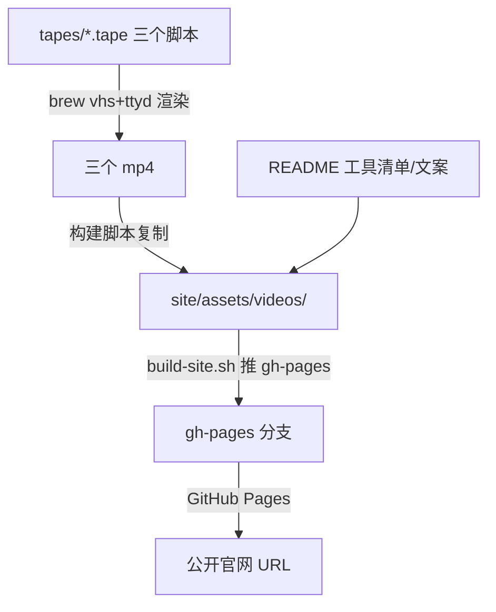

# terminal-setup 官网与视频讲解 — 设计规格

日期：2026-11-22
状态：设计已批准，待写实现计划

## 目标与成功标准

给 `terminal-setup`（Polar Bear 终端环境一键配置工具）做营销向打磨：
1. 把现有单个 `demo.gif` 扩展为 **3 个 mp4 真实终端录屏**，分别讲安装、日常工具、主题与 Git 工作流。
2. 新建**纯静态官网**（终端极客风、中英双语），内嵌 3 个视频并配讲解文案，发布到 GitHub Pages。

成功标准：
- 3 个 mp4 由 VHS 脚本可复现生成，画面文字清晰无乱码。
- 官网本地可访问、视频可播放、语言可切换、手机宽度可用。
- gh-pages 分支上线后，公开 URL 可访问且视频加载正常。
- 全程不把图片读进模型上下文（避免 workbuddy-ai/hy4flash 的 HTTP 400）。

## 已确认的决策（来自头脑风暴）

| 维度 | 选择 |
|---|---|
| 官网形态 | 纯静态站（HTML/CSS/JS，零框架）+ GitHub Pages |
| 发布目标 | gh-pages 分支（同账号站点惯例） |
| 视频数量 | 3 个 |
| 视频主题 | ① 安装 ② 日常工具 ③ 主题与 Git 工作流 |
| 视频生成 | VHS + ffmpeg 真实终端录屏（非 AI 生成） |
| 视觉风格 | 终端极客风，Catppuccin Mocha 配色，等宽字体 |
| 文案语言 | 中英双语，官网带语言切换 |
| mp4 托管 | 直接放仓库，总体积控制在 ~10–20MB |

## 架构

- **源码在 main**：`site/`（静态站源码）、`tapes/`（VHS 脚本）、`scripts/build-site.sh`（构建/发布）。
- **产物在 gh-pages**：由构建脚本从 `site/` 生成并推送；mp4 只进 gh-pages，不进 main（控制 main 体积），`.tape` 脚本留在 main 可随时重建视频。
- 静态站无构建步骤，浏览器直接打开 `index.html` 即可（本地 `python3 -m http.server` 验证）。

## 组件与文件

| 文件 | 职责 |
|---|---|
| `tapes/install.tape` | 录制一键安装流程（克隆/setup.sh/dry-run 预览），简化真实安装避免污染环境 |
| `tapes/daily.tape` | 录制 eza/bat/fzf/zoxide/fastfetch（基于现有 `assets/demo.tape` 扩展） |
| `tapes/git.tape` | 录制 Catppuccin 提示符 + lazygit + delta |
| `site/index.html` | 单页 6 区块：Hero / 特性 / 视频讲解 / 工具全家桶 / 快速开始 / 页脚 |
| `site/styles.css` | Catppuccin Mocha 配色、等宽字体、响应式、视频卡片样式 |
| `site/app.js` | 中英语言切换（data-i18n 属性）、视频懒加载、复制安装命令 |
| `site/assets/videos/*.mp4` | 3 个视频（构建时从渲染结果复制） |
| `scripts/build-site.sh` | 复制 site/ 到临时目录 → 切 gh-pages → 同步 → push |

## 关键流程

### 视频渲染
1. `brew install vhs ttyd`（ffmpeg 已存在）。
2. `vhs tapes/install.tape` → `assets/videos/install.mp4`，另两个同理。
3. 每个 tape 顶部 `Require` 所需工具，缺则早失败；`Set` 指定字体/主题/尺寸，与项目安装效果一致。
4. 视频参数：`Set Theme "Catppuccin Mocha"`、`Set FontFamily "Maple Mono NF CN"`、`Output ...mp4`。

### 本地测试与录制（用户明确要求）
- 本地开控制台（Terminal）实际跑 `setup.sh --dry-run` 与隔离 HOME 安装，确认脚本正常。
- 用 VHS 录制时观察生成的 mp4：时长合理（每个 20–60s）、画面无乱码、命令执行符合预期。
- 录制效果不满意就改 tape 重录，直到清晰可读。

### 官网本地验证
- `cd site && python3 -m http.server 8000`，浏览器打开验证：3 个视频可播放、语言切换生效、手机宽度不溢出。
- 视频用 `<video preload="metadata" controls>` 懒加载，避免首屏加载 3 个大文件。

### 发布
- `scripts/build-site.sh` 把 `site/` 内容同步到 gh-pages 分支并 push。
- 在 GitHub 仓库设置启用 Pages，Source = gh-pages 分支根目录。
- 验证公开 URL 可访问、视频加载正常。

## 错误处理与边界

| 场景 | 处理 |
|---|---|
| 本机缺 vhs/ttyd | 构建脚本检测并提示 `brew install vhs ttyd`，不静默失败 |
| tape 里 `Require` 的工具缺失 | VHS 早失败，先补齐工具再录 |
| 视频体积过大（>20MB 总计） | 调低 VHS `Set Width/Height` 或用 ffmpeg 二次压缩，不换方案 |
| 语言切换缺文案 | data-i18n 属性回退中文，不留空白 |
| 视频文件缺失 | `<video>` 显示 poster/占位文字，页面不崩 |

## 测试计划

1. 3 个 tape 逐个渲染成功，mp4 可播放、时长合理、无乱码。
2. 本地 http server 打开官网：视频播放、语言切换、复制按钮、响应式全部通过。
3. push gh-pages 后公开 URL 可访问、视频加载。
4. 全程未用 `read` 打开图片；VHS 渲染不经模型上下文。

## 范围外（不做）

- 不做 React/Vue 官网（已选纯静态）。
- 不接自定义域名（用 github.io 默认域）。
- 不改 terminal-setup 的 CLI 功能本身（除必要的录制脚本）。
- 不把 mp4 提交进 main 分支。

## 交付物

- 3 个 mp4 + 3 个 tape 脚本。
- 静态官网（main 分支 `site/`）。
- gh-pages 分支上线，公开 URL。
- 构建脚本 `scripts/build-site.sh`。
- 本地测试与录制效果验证记录。
